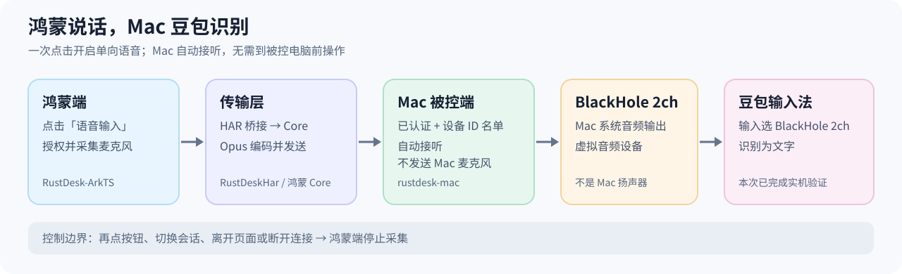

# 鸿蒙 RustDesk → Mac 豆包语音输入

2026-10-08 实机验证：在鸿蒙端远控 Mac 时，点击「语音输入」并说话，Mac 上的豆包输入法能够识别文字；无需走到 Mac 前手动接听。这里的「无需语音通话」指**无需手动拨通和接受**：底层仍复用 RustDesk 的语音请求与音频传输协议。

## 使用前提与操作

1. Mac 安装本项目的 RustDesk 1.5.0，后台 `service` 正常运行。在 RustDesk「设置 → 安全 → 解锁安全设置 → 自动接听指定设备的语音」中填写鸿蒙端的**准确设备 ID**。本次验证使用 `1944352077`；名单留空时仍弹出普通语音通话的「接受/拒绝」。只有已认证、具有音频权限的远控会话会自动接听，不支持 `*` 通配。
2. Mac「系统设置 → 声音」的**输出**选 `BlackHole 2ch`；豆包输入法的**输入**也选 `BlackHole 2ch`。BlackHole 是虚拟音频设备，不是扬声器。切换后 Mac 扬声器听不到这路声音是正常的，以豆包能否识别出字为准；不用时可把系统输出切回扬声器。
3. 鸿蒙端连上 Mac，点击「语音输入」，首次允许麦克风权限。按钮变为「停止语音输入」后启动豆包听写并说话；再点按钮、切换会话、离开页面或断线时停止采集。**未点按钮前不发送鸿蒙麦克风**；自动接听路径不发送 Mac 麦克风。

## 四份代码各负责什么

| 仓库 | 本次职责 |
| --- | --- |
| `RustDesk-ArkTS` | 鸿蒙语音按钮、麦克风权限与录音生命周期。 |
| `RustDeskHar` | ArkTS 和 Rust Core 之间的 HAR/NAPI 桥接。 |
| `R_RustDesk-Core` | 鸿蒙适配的 RustDesk Core：Opus 编码与语音协议发送。本地代码基于 `FrankHan052176/rustdesk4ohos`，推送到个人 fork `hanhzf/rustdesk` 的独立 `feature/ohos-core-voice-input` 分支。 |
| `rustdesk-mac` | 基于官方 RustDesk 的 Mac fork：按已认证设备 ID 自动接听、接收语音并播放到 Mac 当前默认输出；保留 Mac Service，使用个人 fork `hanhzf/rustdesk` 的 `feature/harmony-voice-input` 分支。 |

## 构建、签名和交付时踩过的坑

- **Mac 包必须在 Mac 上构建。** 本次使用 Rust、Xcode 和 Flutter 构建完整 `.app`，确认其中有 `Contents/MacOS/service`。大依赖下载曾借助 fdev01 与 `raknode` 中转，但 Linux 不能代替 Mac 构建 macOS 应用。
- **Mac 固定签名与鸿蒙签名是两套身份。** 已安装的 Mac 版使用本机固定签名证书 `RustDesk Local Signing - HanMacX`，证书和受密码保护的 `.p12` 备份在云盘 `软件/RustDesk/mac/cert/`；密码不写入代码或文档。它保持本机后续构建的签名身份，但不是 Apple Developer ID，也不等于公证。鸿蒙 HAP 则用 HoKit 对已注册设备重签。
- **鸿蒙 Core/HAR/HAP 在 fdev01 构建。** 这次高内存 LTO 构建曾占用过多内存，改用 `CARGO_PROFILE_RELEASE_LTO=false` 完成 Release 构建。`ohpm install` 后曾未把 HAR 的 `librustdesk_native_har.so` 放进依赖目录，必须检查最终 HAP；本次将该库补入 `entry/oh_modules/rustdesk-ohrs/libs/arm64-v8a/` 后重新打包。仅看到 `BUILD SUCCESSFUL` 不足以证明 HAP 可运行。
- **安装前核对产物。** 本次 HAP 为 `top.frankhan.resk`、`1.0.3.56`（`10324211`），含 `ohos.permission.MICROPHONE` 和原生 `.so`；HoKit 签名验证通过，签名证书与上一版一致。Windows 与鸿蒙在同一局域网时，用 `hdc -t <设备IP:端口> install -r <签名HAP>` 覆盖安装，不必卸载原应用。

已验证的包：

- 鸿蒙：云盘 `软件/RustDesk/harmony/RustDesk-HarmonyOS-1.0.3.56-with-voice-signed.hap`；SHA-256 `13399d8d7c0d958e87faa96585a78f4681d255989e1ad63a457b539f1980d8bf`。
- Mac：云盘 `99-inbox/RustDesk-macOS-arm64-1.5.0-harmony-voice-fixed.dmg`；SHA-256 `4a62f0a732ff5f44c4f94e91c20b616d86fbe5bc4ff0d5cd3ec38f8f36c0b316`。当前 `/Applications/RustDesk.app` 的签名校验通过，`service` 正在运行。

排障顺序：Mac 仍弹「接受/拒绝」时先查准确设备 ID 与认证/音频权限；鸿蒙按钮显示「停止语音输入」但豆包无文字时，先查 Mac **输出**与豆包**输入**是否都为 `BlackHole 2ch`。按钮状态只证明录音器已启动，不单独证明有声数据已到达 Mac。
